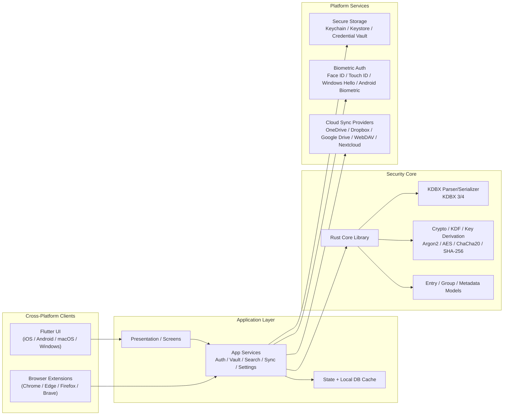

# KeePass-Nexus Technical Specifications

## 1. Overview

KeePass-Nexus is a privacy-first, open-source password manager designed to be fully compatible with KeePass/KeePassXC databases (.kdbx) across iOS, Android, macOS, and Windows.

The project follows a local-first architecture with a Rust-based security core and a Flutter-based user interface. The core objective is to provide a premium user experience without a subscription while maintaining compatibility with the KeePass ecosystem.

---

## 2. Architecture

### 2.1 High-Level Architecture

### 2.2 Layered Design

#### Layer 1: Presentation / UI
- Flutter app shell across supported platforms
- Native-feeling screens for vault browsing, login, settings, and password generator
- Browser extension communication layer for autofill and save-password flows

#### Layer 2: Application Services
- Authentication service
- Database service
- Search/indexing service
- Sync orchestration service
- Clipboard protection service
- Session timeout and auto-lock management

#### Layer 3: Security Core
- Rust library responsible for:
  - KDBX parsing
  - KDBX serialization
  - database key derivation
  - AES/ChaCha20 encryption
  - secure memory handling
- Exposed to Flutter through `flutter_rust_bridge`

#### Layer 4: Platform & Storage Layer
- Local file access
- Secure secret storage
- Cloud provider adapters
- Native OS-specific biometrics and credential APIs

---

## 3. Technology Stack

### 3.1 Frontend
- Flutter
- Dart

### 3.2 Security Core
- Rust
- FFI bridge for cross-language interop

### 3.3 Data Format
- KDBX 3.x and 4.x
- KeePassXC compatibility as primary interoperability target

### 3.4 Secure Storage
- iOS Keychain
- Android Keystore
- macOS Keychain
- Windows Credential APIs

### 3.5 Cloud Integrations
- OneDrive
- Google Drive
- Dropbox
- WebDAV
- Nextcloud
- Local file sync

---

## 4. Functional Requirements

### 4.1 Authentication
- Master password login
- Key file support
- Password + key file combination
- Biometric unlock
- Face ID
- Touch ID
- Windows Hello
- Auto-lock and session timeout support

### 4.2 Database Management
- Create KDBX database
- Open KDBX database
- Edit KDBX database
- Import database
- Export database
- Support KDBX 3.x and 4.x

### 4.3 Password Management
- Create entries
- Edit entries
- Delete entries
- Duplicate entries
- Search
- Favorites
- Recently used entries
- Group and folder hierarchy

### 4.4 Security Features
- Secure clipboard handling
- Auto-clear clipboard
- Copy username/password controls with masking
- Secure storage
- Encryption at rest
- Database lockdown on app backgrounding
- Brute-force resistance

### 4.5 Browser & Autofill
- Browser extension integration
- Autofill login forms
- Save generated credentials
- Update stored credentials

### 4.6 MFA / TOTP / Passkeys
- Time-based one-time passwords
- QR-code import
- TOTP generation
- Passkey/FIDO2 support metadata planning

### 4.7 Synchronization
- OneDrive integration
- Dropbox integration
- Google Drive integration
- WebDAV integration
- Nextcloud integration
- Offline caching and conflict resolution

---

## 5. Non-Functional Requirements

### 5.1 Security
- No plaintext secret storage at rest
- End-to-end encrypted handling of database operations
- Secure memory zeroization after sensitive operations
- Threat modeling and independent review before release

### 5.2 Performance
- Unlock under 2 seconds
- Search results under 200ms
- Responsive UI across mobile and desktop

### 5.3 Reliability
- Offline capability
- Automatic backup/recovery support
- High database open success rate

### 5.4 Accessibility
- Screen reader support
- Keyboard navigation
- Dark mode support

---

## 6. KDBX Compatibility Requirements

### 6.1 Supported Versions
- KDBX 3.x
- KDBX 4.x

### 6.2 Compatibility Target
- KeePassXC compatibility is a primary design goal
- Database behavior should match KeePass-compatible semantics as closely as possible

### 6.3 Parser Requirements
- Detect database file signature and version
- Parse KDF parameters correctly
- Validate header integrity and HMAC
- Handle protected stream encryption and compression
- Serialize KDBX files in standard format

### 6.4 Crypto Requirements
- Argon2 support for modern KDFs
- AES-256 support
- ChaCha20 support
- SHA-256 support
- Secure key derivation logic

### 6.5 Initial Rust Engine
- `rust_core/kdbx` uses the MIT-licensed `keepass` Rust crate, pinned to version 0.15.2.
- The library supplies KDBX 3/4 parsing, KDF/key-file handling, authenticated decryption, protected values, and the database object model.
- The project facade exposes database open/save operations and the underlying typed model; cryptographic primitives are not reimplemented in application code.
- Before derivation, the facade limits file-supplied KDF work by default: Argon2 memory to 256 MiB, iterations to 50, memory-times-iterations to 4 GiB-byte-passes, parallelism to 4 lanes, and AES-KDF to 100 million rounds. `open_with_kdf_limits` allows callers to override these limits for trusted files.
- The dependency describes KDBX 4 writing as experimental. Do not consider writing production-ready until KeePass and KeePassXC fixture interoperability, fuzzing, and independent security review are complete.
- Automated checks cover opening reference KDBX 3.1 and KDBX 4/4.1 fixtures (AES-KDF, Argon2, Argon2id, AES, and ChaCha20), re-encoding a reference KDBX 4.1 database, encrypted round-trip, wrong-password rejection, and tamper rejection. KeePassXC application-level validation is still required; self-round-trip coverage alone does not establish interoperability.
- The writer reopens each generated KDBX file and compares the decoded model before returning bytes to the desktop client. Existing-file saves first create and byte-verify `<database>.nexus-backup`; the prior file remains available for rollback if replacement fails. Saves are refused if the source file changed or disappeared outside the application.
- KDBX 3 files are readable but are not written in place. Saving one requires explicit user confirmation to convert to KDBX 4.1; KDBX 4.0 files similarly require confirmation to upgrade to KDBX 4.1. In both cases, the verified recovery backup must be in place before replacement. Format-specific data beyond the parsed model still requires the external KeePassXC interoperability checks below.
- The selected dependency requires Rust 1.89 or newer.
- Keep the exact dependency version and Cargo lockfile under review for security updates and reproducible builds.

### 6.6 Database CRUD API
- `KdbxDatabase` provides checked create, read, update, and delete operations for groups and entries, including listing direct child IDs.
- Group deletion removes all descendant groups and entries; deleting the root group is rejected. Missing group and entry IDs return explicit errors.
- Entry updates use the underlying history-tracking API, preserving the previous entry state. Mutations are in-memory until encrypted `save_kdbx4` is called.
- CRUD operations use the same parsed database object model and KDBX serialization path, preserving KDBX compatibility and protected-value handling. Callers should use protected-value setters for secrets.
- The facade exposes the underlying `Database` for advanced KDBX features that are not represented by CRUD helpers. KDBX 4 writer maturity caveats in §6.5 still apply.

### 6.7 Windows Flutter Client
- The first desktop client lives in `apps/desktop_flutter`; Flutter provides the login/unlock, database browser, entry editor, search, and settings screens.
- The app calls the Rust engine through `flutter_rust_bridge`; KDBX bytes are read from and written to the selected local database file. The UI never implements KDBX cryptography.
- Entry lists omit passwords; a password is fetched from Rust only for the selected entry details/editor and is masked by default. Password updates are written as protected KDBX fields.
- Master-password and key-file combinations are supported during unlock. Settings are local to the Windows app; inactivity auto-lock is applied while the vault workspace is active.
- KDBX 4 save limitations documented in §6.5 apply to files created or modified by the client.

### 6.8 Entry Icons
- Entry icons are stored using native KDBX icon metadata: the standard KeePass built-in icon index or a custom icon image embedded in the database.
- The entry editor provides a curated set of built-in icons, custom image upload, and favicon download from the URL's origin, trying `/favicon.ico`, `/favicon.png`, and `/apple-touch-icon.png`. Downloaded and uploaded images are normalized to PNG before saving.
- Custom image inputs are limited to 1 MiB and normalized to a maximum 256-by-256 image. The Rust bridge independently enforces the KDBX custom-icon byte limit and validates built-in icon IDs.
- Entry summaries and details expose icon metadata to Flutter for rendering in the entry list and details pane. No app-specific icon data is stored outside the KDBX database.

### 6.9 Entry Tags and Expiration
- Tags use the native KDBX entry `Tags` collection. The editor accepts tags separated by whitespace and searches entries by tag.
- Entry expiration uses the native KDBX `Times/Expires` and `Times/ExpiryTime` metadata; toggling expiration off preserves the selected expiration timestamp while disabling expiry.
- The Flutter/Rust boundary represents expiry as an RFC 3339 timestamp in UTC. KDBX stores timestamps without timezone information or sub-second precision, so the Rust layer converts to/from UTC naive timestamps at second precision.
- When no expiry time is present, the editor initializes its date/time picker with the current local date and time. Presets for hours, days, and weeks add exact durations from selection; month/year presets use calendar arithmetic and clamp to the final valid day of the target month.
- The editor keeps Notes in the same KDBX entry and exposes it with the entry's tags and expiration status in details.

### 6.10 KDBX Compatibility Matrix

The current Windows client uses the `keepass` Rust crate pinned to 0.15.2.
“Tested” means automated open/serialization/reopen checks in this repository;
it does not imply an independent KeePassXC application test.

| Format / KDF / cipher | Open | Save / conversion | Automated evidence |
|---|---|---|---|
| KDBX 3.0, AES-KDF, AES | Tested | Explicitly converts to KDBX 4.1 after backup and confirmation | KeePassXC `Format300.kdbx` fixture |
| KDBX 3.1, AES-KDF, AES | Tested | Explicitly converts to KDBX 4.1 after backup and confirmation | `keepass-rs` reference fixture |
| KDBX 4.0, AES | Tested | Explicitly upgrades to KDBX 4.1 after backup and confirmation | KeePassXC `Format400.kdbx` fixture with custom attributes and attachment |
| KDBX 4.1, Argon2, AES | Tested | Tested | `keepass-rs` reference fixture |
| KDBX 4.1, Argon2id, ChaCha20 | Tested | Tested | `keepass-rs` reference fixture |
| KDBX 4.1, AES-KDF, AES | Tested | Tested | `keepass-rs` reference fixture |
| KeePass 1 / KDB, KDBX 2, unsupported KDF/cipher combinations | Not established | Not supported by the current KDBX 4 writer | Must be rejected or added to a separate verified compatibility scope |

The KeePassXC fixtures are pinned in `rust_core/kdbx/tests/fixtures/README.md`.
The KDBX 4 writer still requires testing by opening Nexus-generated files in
the supported KeePassXC application before a production-compatibility claim.
Self-verification catches malformed output and model loss represented by the
Rust database object model, but it cannot detect fields the parser itself does
not understand or preserve.

---

## 7. Security Requirements

### 7.1 Cryptography
Recommended algorithms:
- Argon2
- AES-256
- ChaCha20
- SHA-256

### 7.2 Secure Storage
- Platform-native secret storage
- Avoid storing sensitive values in plaintext or logs

### 7.3 Memory Protection
- Zeroize temporary memory buffers after use
- Mask entries in the UI
- Avoid clipboard persistence

### 7.4 Threat Protections
- Brute-force resistance
- Clipboard exposure reduction
- Screen-capture protection where possible
- Jailbreak/root detection warnings

### 7.5 Security Reviews
- Static analysis
- Dependency scanning
- Penetration testing
- Independent audit before release

---

## 8. Development Roadmap

### Phase 1: Research (2-4 Weeks)
- Review KDBX specification
- Study KeePassXC interoperability
- Define architecture
- Threat modeling

Deliverables:
- Architecture diagrams
- Technical specs
- Initial security model

### Phase 2: Core Engine (4-8 Weeks)
- KDBX parser
- Crypto layer
- Database CRUD operations
- Unit tests

Deliverables:
- Working password engine

### Phase 3: Flutter Application (6-10 Weeks)
- Login screen
- Database browser
- Entry editor
- Search
- Settings

Deliverables:
- Functional cross-platform app

### Phase 4: Platform Integrations (6-12 Weeks)
- Biometric auth
- Platform secure storage
- OS-specific integration

Deliverables:
- Native authentication support

### Phase 5: Cloud Sync (4-8 Weeks)
- OneDrive
- Google Drive
- Dropbox
- Conflict detection

### Phase 6: AutoFill (6-12 Weeks)
- iOS AutoFill
- Android Autofill service
- Browser extensions

### Phase 7: Security Hardening (4-8 Weeks)
- Fuzz testing
- Penetration testing
- Dependency audit
- Release candidate

---

## 9. Recommended Open Source Libraries

### Flutter
- flutter_rust_bridge
- local_auth
- cryptography
- file_picker
- flutter_secure_storage

### Rust
- keepass (KDBX parsing and writing)
- serde

### KDBX References
- [KeePass KDBX 4.1 file format specification](https://keepass.info/help/kb/kdbx.html)
- [KeePassXC KDBX 4 reader and writer](https://github.com/keepassxreboot/keepassxc/tree/develop/src/format)
- [keepass-rs crate documentation](https://docs.rs/keepass/latest/keepass/)

---

## 10. Team Requirements

### Minimum
- 1 Flutter developer
- 1 Rust/security developer
- 1 QA tester

### Ideal
- Product manager
- Flutter developer
- Rust developer
- Security engineer
- UX designer
- QA engineer

---

## 11. Estimated Effort

### Solo Developer (Part-Time)
- MVP: 6-12 months
- Production-ready: 12-24 months

### Small Team
- MVP: 3-6 months
- Production-ready: 6-12 months

---

## 12. Final Recommendation

The recommended architecture is:

1. Flutter for all user interfaces
2. Rust for cryptography and KeePass/KDBX processing
3. KeePassXC compatibility as the core design goal
4. Local-first architecture with optional sync
5. Native secure storage and biometric unlock
6. Security audit before public release

This architecture balances security, maintainability, cross-platform support, and future extensibility while remaining fully open source.
