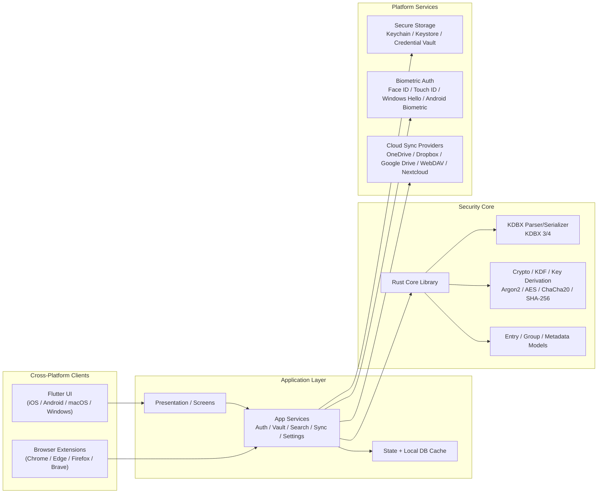

# KeePass-Nexus Technical Specifications

## 1. Overview

KeePass-Nexus is a privacy-first, open-source password manager designed to be fully compatible with KeePass/KeePassXC databases (.kdbx) across iOS, Android, macOS, and Windows.

The project follows a local-first architecture with a Rust-based security core and a Flutter-based user interface. The core objective is to provide a premium user experience without a subscription while maintaining compatibility with the KeePass ecosystem.

---

## 2. Architecture

### 2.1 High-Level Architecture

### 2.2 Layered Design

#### Layer 1: Presentation / UI
- Flutter app shell across supported platforms
- Native-feeling screens for vault browsing, login, settings, and password generator
- Browser extension communication layer for autofill and save-password flows

#### Layer 2: Application Services
- Authentication service
- Database service
- Search/indexing service
- Sync orchestration service
- Clipboard protection service
- Session timeout and auto-lock management

#### Layer 3: Security Core
- Rust library responsible for:
  - KDBX parsing
  - KDBX serialization
  - database key derivation
  - AES/ChaCha20 encryption
  - secure memory handling
- Exposed to Flutter through FFI or a platform boundary

#### Layer 4: Platform & Storage Layer
- Local file access
- Secure secret storage
- Cloud provider adapters
- Native OS-specific biometrics and credential APIs

---

## 3. Technology Stack

### 3.1 Frontend
- Flutter
- Dart

### 3.2 Security Core
- Rust
- FFI bridge for cross-language interop

### 3.3 Data Format
- KDBX 3.x and 4.x
- KeePassXC compatibility as primary interoperability target

### 3.4 Secure Storage
- iOS Keychain
- Android Keystore
- macOS Keychain
- Windows Credential APIs

### 3.5 Cloud Integrations
- OneDrive
- Google Drive
- Dropbox
- WebDAV
- Nextcloud
- Local file sync

---

## 4. Functional Requirements

### 4.1 Authentication
- Master password login
- Key file support
- Password + key file combination
- Biometric unlock
- Face ID
- Touch ID
- Windows Hello
- Auto-lock and session timeout support

### 4.2 Database Management
- Create KDBX database
- Open KDBX database
- Edit KDBX database
- Import database
- Export database
- Support KDBX 3.x and 4.x

### 4.3 Password Management
- Create entries
- Edit entries
- Delete entries
- Duplicate entries
- Search
- Favorites
- Recently used entries
- Group and folder hierarchy

### 4.4 Security Features
- Secure clipboard handling
- Auto-clear clipboard
- Copy username/password controls with masking
- Secure storage
- Encryption at rest
- Database lockdown on app backgrounding
- Brute-force resistance

### 4.5 Browser & Autofill
- Browser extension integration
- Autofill login forms
- Save generated credentials
- Update stored credentials

### 4.6 MFA / TOTP / Passkeys
- Time-based one-time passwords
- QR-code import
- TOTP generation
- Passkey/FIDO2 support metadata planning

### 4.7 Synchronization
- OneDrive integration
- Dropbox integration
- Google Drive integration
- WebDAV integration
- Nextcloud integration
- Offline caching and conflict resolution

---

## 5. Non-Functional Requirements

### 5.1 Security
- No plaintext secret storage at rest
- End-to-end encrypted handling of database operations
- Secure memory zeroization after sensitive operations
- Threat modeling and independent review before release

### 5.2 Performance
- Unlock under 2 seconds
- Search results under 200ms
- Responsive UI across mobile and desktop

### 5.3 Reliability
- Offline capability
- Automatic backup/recovery support
- High database open success rate

### 5.4 Accessibility
- Screen reader support
- Keyboard navigation
- Dark mode support

---

## 6. KDBX Compatibility Requirements

### 6.1 Supported Versions
- KDBX 3.x
- KDBX 4.x

### 6.2 Compatibility Target
- KeePassXC compatibility is a primary design goal
- Database behavior should match KeePass-compatible semantics as closely as possible

### 6.3 Parser Requirements
- Detect database file signature and version
- Parse KDF parameters correctly
- Validate header integrity and HMAC
- Handle protected stream encryption and compression
- Serialize KDBX files in standard format

### 6.4 Crypto Requirements
- Argon2 support for modern KDFs
- AES-256 support
- ChaCha20 support
- SHA-256 support
- Secure key derivation logic

---

## 7. Security Requirements

### 7.1 Cryptography
Recommended algorithms:
- Argon2
- AES-256
- ChaCha20
- SHA-256

### 7.2 Secure Storage
- Platform-native secret storage
- Avoid storing sensitive values in plaintext or logs

### 7.3 Memory Protection
- Zeroize temporary memory buffers after use
- Mask entries in the UI
- Avoid clipboard persistence

### 7.4 Threat Protections
- Brute-force resistance
- Clipboard exposure reduction
- Screen-capture protection where possible
- Jailbreak/root detection warnings

### 7.5 Security Reviews
- Static analysis
- Dependency scanning
- Penetration testing
- Independent audit before release

---

## 8. Development Roadmap

### Phase 1: Research (2-4 Weeks)
- Review KDBX specification
- Study KeePassXC interoperability
- Define architecture
- Threat modeling

Deliverables:
- Architecture diagrams
- Technical specs
- Initial security model

### Phase 2: Core Engine (4-8 Weeks)
- KDBX parser
- Crypto layer
- Database CRUD operations
- Unit tests

Deliverables:
- Working password engine

### Phase 3: Flutter Application (6-10 Weeks)
- Login screen
- Database browser
- Entry editor
- Search
- Settings

Deliverables:
- Functional cross-platform app

### Phase 4: Platform Integrations (6-12 Weeks)
- Biometric auth
- Platform secure storage
- OS-specific integration

Deliverables:
- Native authentication support

### Phase 5: Cloud Sync (4-8 Weeks)
- OneDrive
- Google Drive
- Dropbox
- Conflict detection

### Phase 6: AutoFill (6-12 Weeks)
- iOS AutoFill
- Android Autofill service
- Browser extensions

### Phase 7: Security Hardening (4-8 Weeks)
- Fuzz testing
- Penetration testing
- Dependency audit
- Release candidate

---

## 9. Recommended Open Source Libraries

### Flutter
- flutter_rust_bridge
- local_auth
- cryptography
- file_picker
- flutter_secure_storage

### Rust
- argon2
- aes-gcm
- chacha20poly1305
- serde
- tokio

---

## 10. Team Requirements

### Minimum
- 1 Flutter developer
- 1 Rust/security developer
- 1 QA tester

### Ideal
- Product manager
- Flutter developer
- Rust developer
- Security engineer
- UX designer
- QA engineer

---

## 11. Estimated Effort

### Solo Developer (Part-Time)
- MVP: 6-12 months
- Production-ready: 12-24 months

### Small Team
- MVP: 3-6 months
- Production-ready: 6-12 months

---

## 12. Final Recommendation

The recommended architecture is:

1. Flutter for all user interfaces
2. Rust for cryptography and KeePass/KDBX processing
3. KeePassXC compatibility as the core design goal
4. Local-first architecture with optional sync
5. Native secure storage and biometric unlock
6. Security audit before public release

This architecture balances security, maintainability, cross-platform support, and future extensibility while remaining fully open source.
